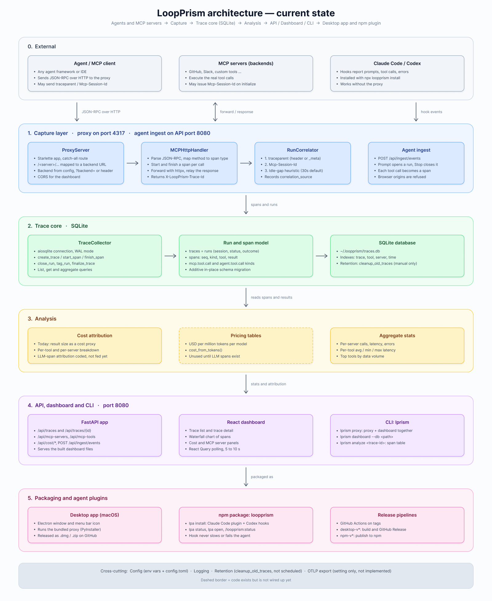
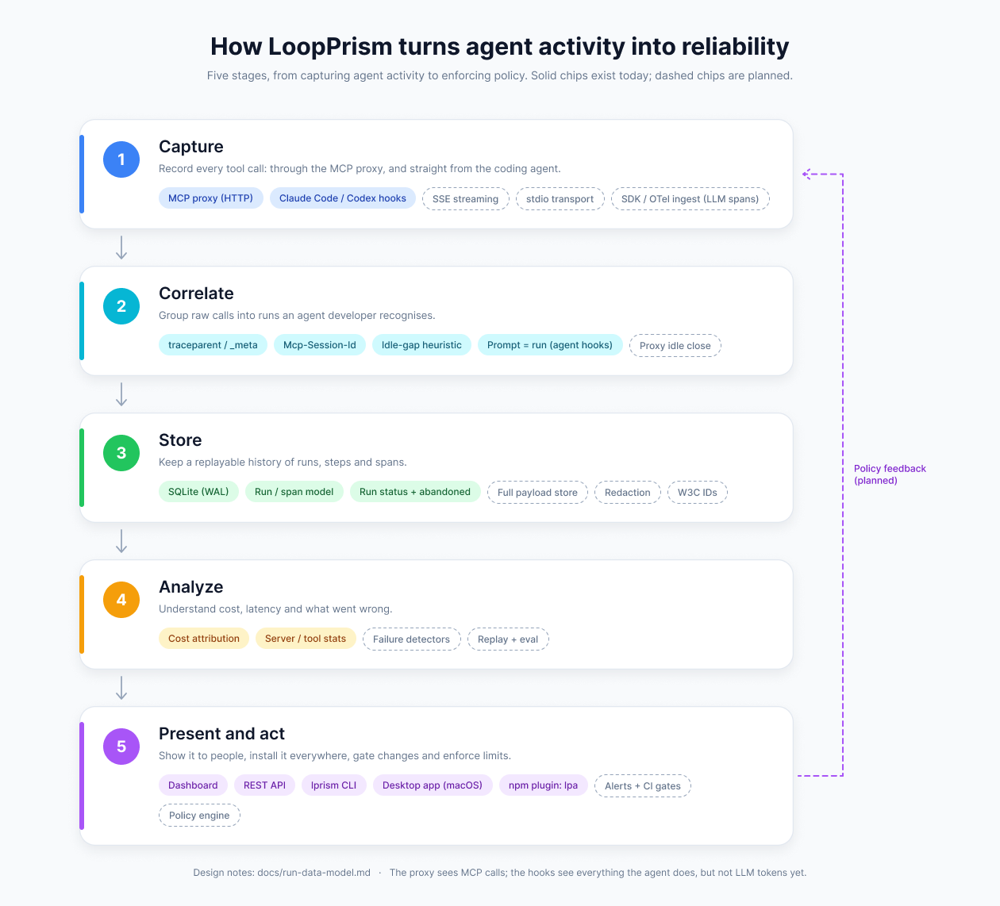

<h1 align="center"> LoopPrism</h1>

<p align="center"><em>See what your agents actually do.</em></p>

<p align="center">
  <a href="https://github.com/AMark-CS/LoopPrism"></a>
  <a href="./LICENSE"></a>
</p>

---

## What is LoopPrism?

LoopPrism is an **inspector for coding-agent harnesses**. It reads what Claude Code and Codex
leave on disk and shows you what the agent actually did: every session, step by step, what filled
the model's context, where the time and the money went. It can also sit in front of MCP servers
and record every tool call, and it records live runs through hooks.

<p align="center">
  
</p>

<sub>Screenshots use made-up sessions generated by
[`scripts/make_demo_sessions.py`](scripts/make_demo_sessions.py), not real work.</sub>

**Three ways to use it** (they share one local database, `~/.loopprism/traces.db`):

| You want | Use |
|---|---|
| A double-click app that works out of the box, no Python or terminal | [Desktop app](#desktop-app-macos) |
| To browse and inspect your Claude Code / Codex sessions | the app, or `lprism proxy` and open `http://localhost:8080` |
| Every tool call of a live agent, not only MCP | [`npx loopprism install`](#live-runs-claude-code-and-codex-hooks) |
| MCP calls from any HTTP MCP client, or a headless proxy | [`lprism proxy`](#mcp-proxy) |

## Features

- **Sessions** — every Claude Code and Codex session on your machine: search, group, resume in Terminal, export, move to the Trash
- **Trajectory** — a timeline of every step with durations, search, and flagged patterns (the same tool called again and again, runs of failing tool calls)
- **Context** — what filled the model's input at each step: system prompt, tool schemas, your messages, injected context, skills, tool results; window fill, trend, cache hit rate
- **Cost** — estimated at the providers' current API prices from real token usage, split by token type, by what filled the context, by model and by turn
- **Timing** — thinking vs answering vs tool time, tokens per second
- **MCP tracing** — a proxy that records every `tools/call`, `tools/list`, `prompts/get`… with timing, result size and errors
- **Local-first** — everything stays on your machine; SQLite on disk, no Docker, no cloud

## Desktop app (macOS)

Download the latest `.dmg` from the
[Releases page](https://github.com/AMark-CS/LoopPrism/releases/latest): `arm64` for Apple
Silicon, `x64` for Intel. Drag **LoopPrism** into Applications and open it. It bundles the
proxy and the dashboard (no Python needed), opens on your sessions, and keeps running from the
menu bar. On first launch it connects Claude Code and Codex for you (switch them off or on later
in the **Apps** page), so there is nothing to install or configure; it also reuses a `lprism proxy`
you already have running instead of starting a second one.

The app is not signed or notarized yet, so macOS blocks the first launch: right-click the
app and choose **Open**, or run `xattr -dr com.apple.quarantine /Applications/LoopPrism.app`.
More in [desktop/README.md](desktop/README.md).

## Session inspector

The app (and `http://127.0.0.1:8080` when you run `lprism proxy`) opens on **Sessions**: every
Claude Code and Codex session on your machine, read straight from their own session files, with
nothing to install or configure.

- **Sessions**: search across all of them, group by day or project, resume a session in Terminal
  (or copy the `claude --resume` / `codex resume` command), export to Markdown, move to the Trash.
- **Chat**: the conversation, tool calls expandable.
- **Trajectory**: every step (prompt, injected context, thinking, tool call, result) on a timeline
  with durations, search, and flagged patterns.
- **Context**: the per-step breakdown, window fill, trend, cache hit rate, cost and timing.

<p align="center">
  
</p>

<p align="center">
  
</p>

**How exact is it?** Claude Code 2.1.308 and newer record the exact request every step sent
(system prompt, tool schemas, messages), so for those sessions the breakdown by category is
exact in content and scaled to the token counts the model reported. Codex rollouts contain the
system prompt, tool schemas and conversation, so those are near-exact. For older Claude Code
sessions the system prompt and tool schemas are not recorded and are inferred as whatever the
conversation does not explain. Each session is labelled *Exact request* or *Estimated*. Timing
comes from the session's timestamps; exact time-to-first-token needs the optional API capture proxy.

### Cost estimates

The cost is the session's token usage priced at Anthropic's and OpenAI's published API prices
(cache reads and writes included; see `src/loopprism/cost/pricing.py`, dated `PRICING_AS_OF`). It is
what the work would cost on the API: Claude Pro/Max and ChatGPT plans bill differently, and models
without a published price show no cost rather than a guess. Put overrides in
`~/.loopprism/pricing.json`:

```json
{"claude-opus-5-5": {"input": 4, "output": 20, "cache_read": 0.2, "cache_write": 5, "cache_write_1h": 8}}
```

### Privacy and safety

Session content (prompts, code, tool output) never leaves your machine. The session endpoints
only answer requests from your own dashboard (loopback host, same origin), so other websites
cannot read or delete sessions. Deleting moves a session file to the Trash and only works inside
Claude Code's and Codex's own session folders.

## Live runs: Claude Code and Codex hooks

Sessions are read after the fact. To also record what an agent does **as it happens** (every
shell command, file edit and built-in tool, plus the prompt behind each piece of work), install
the hooks; the desktop app does this for you, or:

```bash
npx loopprism install      # Claude Code and/or Codex, whichever is installed
lpa status                 # newest runs (after: npm install -g loopprism)
```

Start LoopPrism first (the desktop app, or `lprism proxy`), then restart your agent. In Codex,
run `/hooks` once to trust the new hooks. Claude Code can also use the plugin directly:
`/plugin marketplace add AMark-CS/LoopPrism`, then `/plugin install loopprism@loopprism`. Details,
privacy options and uninstall are in [npm/README.md](npm/README.md). Each prompt becomes a run;
tool calls become spans; token usage is priced when the turn ends. They appear under **Live runs**.

## MCP proxy

For MCP traffic (the proxy only sees MCP calls over HTTP), run the proxy and point your clients at it:

```bash
pip install "git+https://github.com/AMark-CS/LoopPrism.git"
# or: uv tool install git+https://github.com/AMark-CS/LoopPrism.git
lprism proxy --port 4317
```

```
╭─────────────────────────────────────────────────────╮
│              loopprism                              │
│      "See what your agents actually do"            │
├─────────────────────────────────────────────────────┤
│  Proxy:     http://localhost:4317                   │
│  Dashboard: http://localhost:8080                   │
│  Database:  ~/.loopprism/traces.db                  │
╰─────────────────────────────────────────────────────╯
```

```jsonc
// Claude Desktop config (~/.claude/settings.json)
{
  "mcpServers": {
    "github": {
      "url": "http://localhost:4317/github?backend=https://api.github.com/mcp"
    },
    "filesystem": {
      "url": "http://localhost:4317/fs?backend=http://localhost:3001"
    }
  }
}
```

Every MCP tool call then appears under **Live runs** with a waterfall of timing and latency, and
per-server and per-tool stats.

## Architecture

```
Agent ──▶ LoopPrism Proxy ──▶ MCP Server
              │
              ├── Intercepts JSON-RPC
              ├── Extracts tool name, args, latency
              ├── Writes to SQLite (~/.loopprism/traces.db)
              └── Serves Dashboard (http://localhost:8080)
```

Current layers, top to bottom (capture, trace core, analysis, API / dashboard / CLI, packaging):



Where it is heading, with built and planned pieces (solid vs dashed):



Source files are in Figma: [LoopPrism architecture](https://www.figma.com/design/RZP1ns1hfsPffaEZFOYlqt) (private to the author's team until shared). Data model details: [docs/run-data-model.md](docs/run-data-model.md).

## Commands

```bash
# Start proxy + built-in dashboard (default)
lprism proxy

# Custom ports
lprism proxy --port 4317 --dashboard-port 8080

# Proxy only (no dashboard)
lprism proxy --no-dashboard

# Standalone dashboard (connect to a remote DB)
lprism dashboard --db ~/.loopprism/remote.db

# Analyze a specific trace
lprism analyze <trace-id>

# Debug verbose mode
lprism proxy --verbose
```

## API

The dashboard is backed by a REST API:

| Endpoint | Description |
|----------|-------------|
| `GET /api/traces` | List traces |
| `GET /api/traces/:id` | Get trace with all spans |
| `GET /api/mcp-servers` | Stats per MCP server |
| `GET /api/mcp-tools` | Stats per tool |
| `GET /api/cost/summary` | Cost overview (runs, tool calls, estimated cost) |
| `GET /api/cost/trace/:id` | Cost breakdown per trace |
| `POST /api/ingest/events` | Agent hook events (used by the hooks) |
| `GET /api/sessions` | Indexed Claude Code / Codex sessions (`q`, `agent`, `project`) |
| `GET /api/sessions/:id` | Session details, stats and findings |
| `GET /api/sessions/:id/events` | Trajectory events (`kinds`, `q`, `preview`) |
| `GET /api/sessions/:id/trajectory` | Steps, turns and flagged patterns |
| `GET /api/sessions/:id/context` | Context stats and per-step trend |
| `GET /api/sessions/:id/context/:step` | One step's context breakdown with items |
| `GET /api/sessions/:id/cost` | Cost by token type, context category, model and turn |
| `GET /api/sessions/:id/timing` | Where the time went |
| `GET /api/sessions/:id/export.md` | Markdown export |
| `POST /api/sessions/:id/resume`, `/delete` | Resume in Terminal / move to Trash |
| `GET /api/health` | Health check |

## Development

```bash
git clone git@github.com:AMark-CS/LoopPrism.git
cd LoopPrism
pip install -e ".[dev]"
pytest

# Dashboard dev server
cd dashboard
npm install
npm run dev

# Try the session inspector on made-up sessions (not your own)
python scripts/make_demo_sessions.py /tmp/lp-demo
CLAUDE_CONFIG_DIR=/tmp/lp-demo/.claude CODEX_HOME=/tmp/lp-demo/.codex lprism proxy

# Build the desktop app (macOS): see desktop/README.md
```

## Rename compatibility

LoopPrism was previously named toolglass. The Python package is `loopprism` and the CLI command is `lprism`; the former `toolglass` and `loopprism` commands no longer exist. `TOOLGLASS_*` environment variables and incoming `X-Toolglass-*` headers remain supported. New environment variables use `LOOPPRISM_*` and take precedence. Existing `~/.toolglass/traces.db` and `config.toml` are used when their new equivalents are absent; no data is moved or deleted.

Install from GitHub for now; this repository does not yet provide a published `loopprism` PyPI release.

## License

MIT
