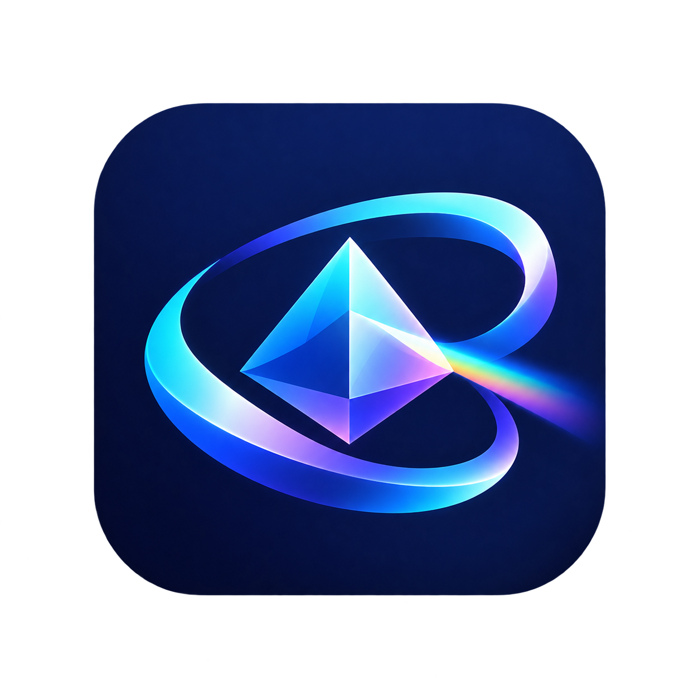
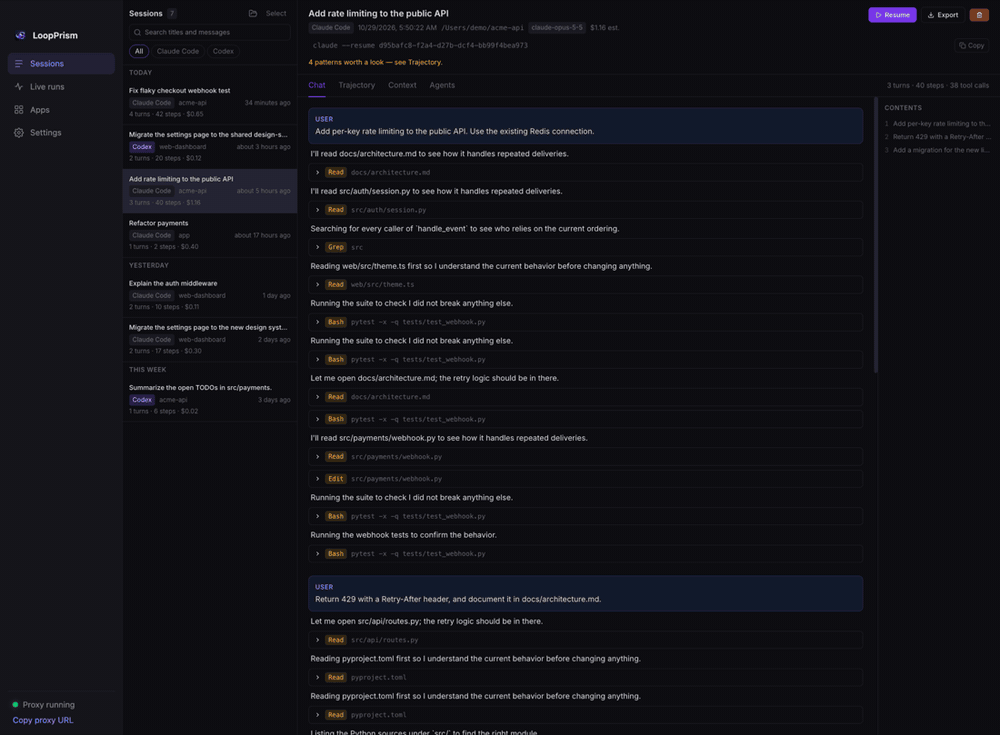
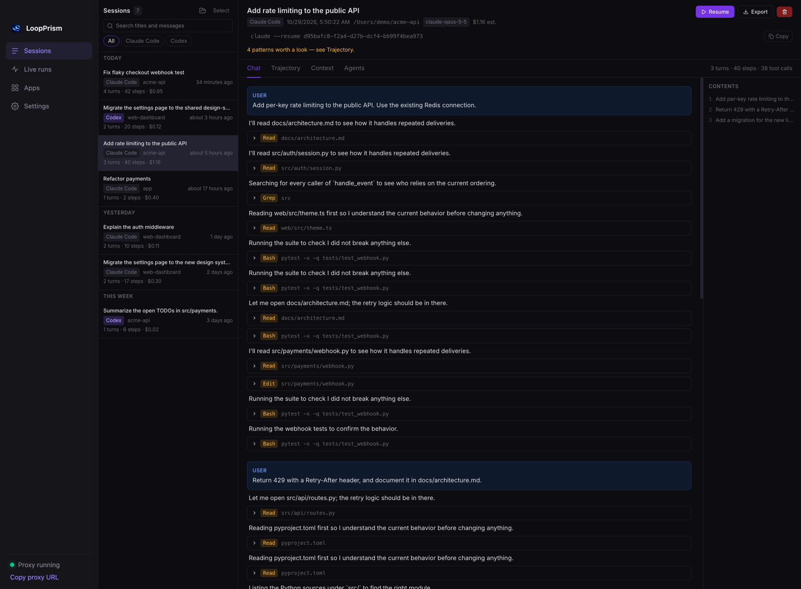
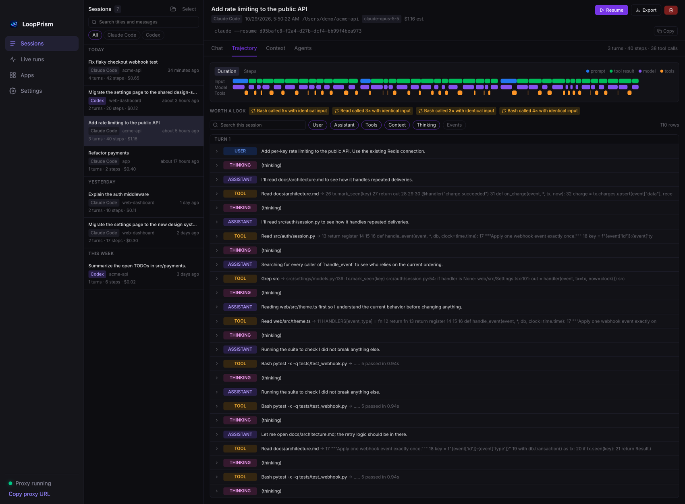
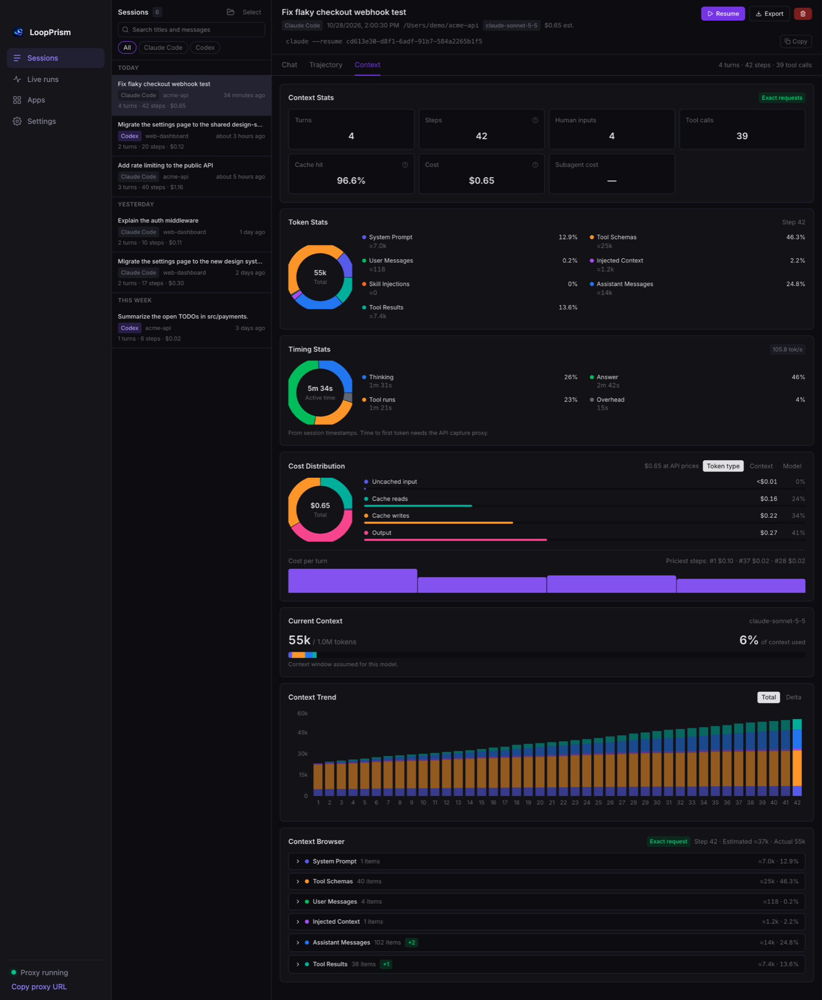
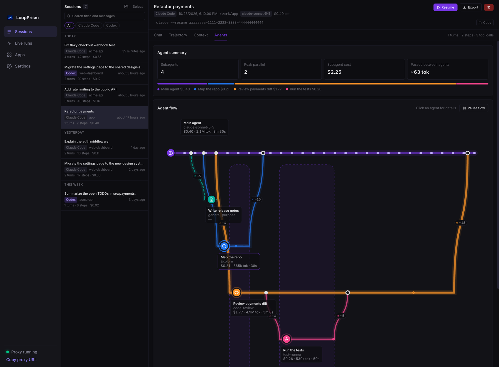
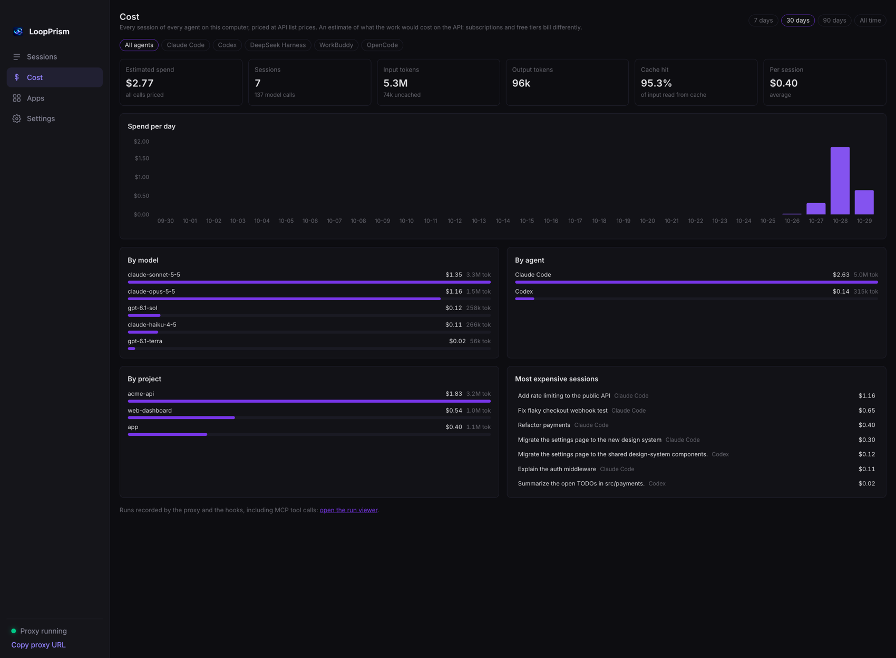

<h1 align="center">&nbsp;LoopPrism</h1>

<p align="center"><strong>See what your coding agents actually do.</strong></p>

<p align="center">
  An inspector for Claude Code, Codex, OpenCode, DeepSeek Harness and WorkBuddy: every session, step by step.<br>
  What filled the context, where the time went, what it cost. Local-first, zero setup.
</p>

<p align="center">
  <a href="https://github.com/AMark-CS/LoopPrism/releases/latest"></a>
  <a href="https://www.npmjs.com/package/loopprism"></a>
  
  
  
  <a href="./LICENSE"></a>
</p>

<p align="center">
  <b>English</b> · <a href="README.zh-CN.md">简体中文</a>
</p>

<p align="center">
  <a href="https://github.com/AMark-CS/LoopPrism/releases/latest"><b>Download</b></a> ·
  <a href="#features">Features</a> ·
  <a href="#get-started">Get started</a>
</p>

<br>

<p align="center">
  
</p>

<table>
  <tr>
    <td width="50%"></td>
    <td width="50%"></td>
  </tr>
  <tr>
    <td align="center"><sub><b>Chat</b> — the conversation, with every tool call expandable</sub></td>
    <td align="center"><sub><b>Trajectory</b> — every step on a timeline, loops and failure streaks flagged</sub></td>
  </tr>
  <tr>
    <td width="50%"></td>
    <td width="50%"></td>
  </tr>
  <tr>
    <td align="center"><sub><b>Context</b> — what filled the context, where the time and the money went</sub></td>
    <td align="center"><sub><b>Agents</b> — subagents branching off and merging back, with what was passed between them</sub></td>
  </tr>
  <tr>
    <td colspan="2"></td>
  </tr>
  <tr>
    <td colspan="2" align="center"><sub><b>Cost</b> — everything your agents spent, across every app, in one place</sub></td>
  </tr>
</table>

<p align="center"><sub>Made-up demo sessions, generated by <a href="scripts/make_demo_sessions.py"><code>scripts/make_demo_sessions.py</code></a> and <a href="tests/support_agents.py"><code>tests/support_agents.py</code></a>.</sub></p>

<br>

## Features

<table>
  <tr>
    <td width="50%" valign="top">
      <h4>🗂 Sessions</h4>
      Every Claude Code, Codex, OpenCode, DeepSeek Harness (<code>dsh</code>) and WorkBuddy session on your
      machine. Search all messages, group by day or project, export to Markdown. Claude Code and
      Codex sessions can also be resumed in a terminal or moved to the Trash from here; the other
      others are read-only.
    </td>
    <td width="50%" valign="top">
      <h4>🧭 Trajectory</h4>
      Every step on a timeline: prompt, injected context, thinking, tool call, result. With
      durations, search, and flagged patterns: the same call again and again, runs of failures.
    </td>
  </tr>
  <tr>
    <td valign="top">
      <h4>🧮 Context</h4>
      What filled the model's input at each step: system prompt, tool schemas, your messages,
      injected context, skills, tool results. Window fill, trend, cache hit rate.
    </td>
    <td valign="top">
      <h4>💸 Cost</h4>
      Real token usage priced at API list prices, split by token type, by what filled the context,
      by model and by turn. The <b>Cost</b> page adds up every session of every app: per day, model,
      agent and project, plus the most expensive sessions.
    </td>
  </tr>
  <tr>
    <td valign="top">
      <h4>⏱ Timing</h4>
      Thinking vs answering vs tool time, and tokens per second.
    </td>
    <td valign="top">
      <h4>🔌 MCP tracing &amp; live runs</h4>
      An optional proxy records every MCP tool call; hooks record what an agent does as it happens
      (the run viewer is linked from the Cost page).
    </td>
  </tr>
  <tr>
    <td colspan="2" valign="top">
      <h4>⚡ Optimize</h4>
      Finds where you spend more than you need to (low cache hits, a big model on a simple task,
      repeated calls, huge tool outputs, endless sessions), estimates the saving of each, and shows
      the total as a percentage of your spend. Mark a suggestion as adopted and LoopPrism compares
      your cost per call before and after. It also points to open-source tools that help, found on
      GitHub. Optional AI analysis uses a model and API key of your own choice.
    </td>
  </tr>
  <tr>
    <td colspan="2" valign="top">
      <h4>🤖 Agents</h4>
      A session that spawns subagents gets a flow view: the main agent as a line, each subagent
      branching off and merging back, with what it was asked, what it returned, its cost, and how
      much ran in parallel. Open any subagent's own conversation. (Claude Code; Codex agent trees
      are not read yet.)
    </td>
  </tr>
  <tr>
    <td colspan="2" valign="top">
      <h4>🎨 Look &amp; language</h4>
      Dark, light or follow-the-system theme, and an interface in English or 简体中文 (or follow the
      system). Both are chosen in Settings and apply to the whole app, including the dashboard.
    </td>
  </tr>
</table>

## Supported apps and models

LoopPrism runs on **macOS** and **Windows** with the same features on both: the desktop app, the `lprism` CLI, the hooks and the dashboard behave identically (only the system's own wording differs, such as Trash and Recycle Bin).

| App | Sessions (read from disk) | Live runs (hooks) | Resume / delete here |
|---|---|---|---|
| **Claude Code** | `~/.claude/projects` (also subagent trees) | yes, plugin | yes |
| **Codex** | `~/.codex/sessions` | yes, `~/.codex/hooks.json` | yes |
| **OpenCode** | `~/.local/share/opencode/opencode.db` | yes, a plugin in `~/.config/opencode/plugins` | read-only |
| **DeepSeek Harness** (`dsh`) | `~/.dsh/sessions` (zstd), `$DSH_HOME` | not yet | read-only |
| **WorkBuddy** | `~/.workbuddy/projects`, `$WORKBUDDY_CONFIG_DIR` | yes, `~/.workbuddy/settings.json` | read-only |

Cost is priced from each model's published pay-as-you-go API price (cache reads and writes
priced separately). Built in: **Claude** (Fable, Opus, Sonnet, Haiku), **OpenAI** (GPT-6, GPT-5 and
Codex models), **DeepSeek** (chat, reasoner, V3.x, R1 and later versions), **MiniMax** (M2 and later),
**GLM** (4.5 to 5.x), **Qwen** (Max, Plus, Flash, Coder), **Kimi** (K2), **Gemini** (2.5, 3), and
free tiers such as OpenCode Zen's `-free` models. A newer version of a family is priced like
the latest known one; OpenCode's own reported cost is used when we have no price, and models with
no price at all (for example Tencent's `hy3`) show "no price" and are left out of totals. Set or
correct any price in `~/.loopprism/pricing.json`. Costs are what the work would cost on the API:
subscriptions and free tiers bill differently.

Everything stays on your machine: SQLite on disk, no Docker, no cloud, no account.

## Get started

### Desktop app (macOS and Windows) — recommended

**macOS**

1. Download the `.dmg` from the [latest release](https://github.com/AMark-CS/LoopPrism/releases/latest)
   (`arm64` for Apple Silicon, `x64` for Intel) and drag **LoopPrism** into Applications.
2. Open it. First launch: right-click the app → **Open** (it is not notarized yet), or
   `xattr -dr com.apple.quarantine /Applications/LoopPrism.app`.

**Windows (x64)**

1. Download `LoopPrism-<version>-x64.exe` from the [latest release](https://github.com/AMark-CS/LoopPrism/releases/latest)
   and run it. The installer lets you choose the install folder
   and whether to install for just you (default, no administrator prompt) or for everyone on the PC.
2. It is not code-signed yet, so SmartScreen may warn: click **More info → Run anyway**.

That's it. The app bundles everything (no Python, no terminal), opens on your sessions, connects
Claude Code and Codex for live runs, and keeps running from the menu bar (macOS) or system tray (Windows). Details:
[desktop/README.md](desktop/README.md).

### Command line

```bash
pip install "git+https://github.com/AMark-CS/LoopPrism.git"   # or: uv tool install git+https://github.com/AMark-CS/LoopPrism.git
lprism proxy                                                    # then open http://localhost:8080
```

### Live runs from Claude Code, Codex and WorkBuddy

Sessions are read after the fact. To also watch an agent **as it works**:

```bash
npx loopprism install     # adds the hooks to Claude Code, Codex, WorkBuddy and/or OpenCode, whichever you have
lpa status                # newest runs
```

Claude Code can also use the plugin directly (`/plugin marketplace add AMark-CS/LoopPrism`, then
`/plugin install loopprism@loopprism`). In Codex, run `/hooks` once to trust the hooks; restart
WorkBuddy and OpenCode after installing (OpenCode gets a one-file plugin). DeepSeek Harness sessions are read from `~/.dsh` (or `$DSH_HOME`), and
WorkBuddy's from `~/.workbuddy` (or `$WORKBUDDY_CONFIG_DIR`), and OpenCode's from its database, with
nothing to set up; DeepSeek Harness has no live-run hook yet. Privacy options and uninstall: [npm/README.md](npm/README.md).

## License

[MIT](./LICENSE)

## Star History

<a href="https://star-history.com/#AMark-CS/LoopPrism&Date">
  <picture>
    <source media="(prefers-color-scheme: dark)" srcset="https://api.star-history.com/svg?repos=AMark-CS/LoopPrism&type=Date&theme=dark" />
    <source media="(prefers-color-scheme: light)" srcset="https://api.star-history.com/svg?repos=AMark-CS/LoopPrism&type=Date" />
    
  </picture>
</a>
